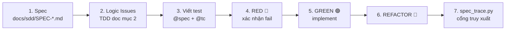

# Elemoni — Spec-Driven Development (SDD) & TDD Hub

Trung tâm đặc tả và kiểm thử của Elemoni, áp dụng theo mô hình dự án DENSO `robotics-humanoid`
(`docs/sdd/SPEC-*.md` + thẻ `@spec` + cổng truy xuất) và mẫu `TDD_TEMPLATE_V1` (ISO/IEC/IEEE 29119-3).

## Quy trình

1. **Spec** — 4 thành phần: Scope (In/Out), Behavior, Edge Cases `EC-xx`, Success Criteria `AC-xx`, kèm ma trận truy xuất mục 6.
2. **TDD doc** (`docs/tdd/TDD-ELM-*.md`) — Logic Issues Resolved → TDS-01..05 → Test Case Specification → RGR Tracker → Entry/Exit → Rollback.
3. **Test** — docstring mang `@spec: SPEC-ELM-XX#AC-01` và `@tc: XX-TC-001`.
4. **Cổng** — `python scripts/spec_trace.py` kiểm 2 chiều (AC/EC → test, TC → test), mã thoát ≠ 0 nếu thiếu hoặc có thẻ mồ côi.

## Ma trận đặc tả & truy xuất

| Spec | Module | TDD doc | Test neo | AC+EC | TC | RED xác nhận |
|---|---|---|---|:---:|:---:|:---:|
| [SPEC-ELM-L1](SPEC-ELM-L1_rule_engine_safety.md) | Lớp 1 — Rule Engine (P0, an toàn) | [TDD-ELM-L1](../tdd/TDD-ELM-L1_rule_engine.md) | `tests/test_rule_engine.py` | 11 | 12 | 4 |
| [SPEC-ELM-L2A](SPEC-ELM-L2A_fridge_duty_cycle.md) | Lớp 2 — Duty Cycle | [TDD-ELM-L2A](../tdd/TDD-ELM-L2A_duty_cycle.md) | `tests/test_duty_cycle.py` | 10 | 11 | 3 |
| [SPEC-ELM-L2B](SPEC-ELM-L2B_vampire_power.md) | Lớp 2 — Vampire Power | [TDD-ELM-L2B](../tdd/TDD-ELM-L2B_vampire_power.md) | `tests/test_vampire_power.py` | 8 | 6 | 2 |
| [SPEC-ELM-L3](SPEC-ELM-L3_inverter_autoencoder.md) | Lớp 3 — Autoencoder | [TDD-ELM-L3](../tdd/TDD-ELM-L3_autoencoder.md) | `tests/test_autoencoder.py` | 7 | 6 | 3 |
| [SPEC-ELM-NILM](SPEC-ELM-NILM_seq2point.md) | NILM — Seq2Point | [TDD-ELM-NILM](../tdd/TDD-ELM-NILM_seq2point.md) | `tests/test_seq2point.py` | 8 | 7 | 1 |
| [SPEC-ELM-SYS-001](SPEC-ELM-SYS-001_poc_detective_pipeline.md) | POC end-to-end | [TDD-ELM-SYS-001](../tdd/TDD-ELM-SYS-001_poc_pipeline.md) | `tests/integration/test_poc_pipeline.py` | 5 | 5 | 5 |
| **Tổng** | | | | **49** | **47** | **18** |

TC không có RED là **characterization test**: hành vi đã đúng từ trước, test viết sau để khóa hành vi đó.

## Cổng chất lượng
| Gate | Lệnh | Tiêu chí |
|---|---|---|
| G1 — Truy xuất | `python scripts/spec_trace.py` | 100% AC/EC và 100% TC có test, không thẻ mồ côi |
| G2 — Unit + Integration | `python -m pytest` | Xanh toàn bộ, không skip |
| G3 — Coverage | `python -m pytest --cov=src --cov=demo_pipeline` | ≥ 80% lines |
| G4 — Ngưỡng an toàn | `L1-TC-012` (trong G2) | Bảng ngưỡng khớp `SPEC-ELM-L1` §3.4 |
| G5 — POC | `python demo_pipeline.py` | Mã thoát 0 |

## Giới hạn cần nói thẳng
- **Spec được viết ngược (reverse-spec)** sau khi code đã có — giống tình trạng của DENSO `robotics-humanoid`. Từ nay, tính năng mới phải spec-first.
- **100% thẻ ≠ 100% đúng**: `spec_trace.py` chỉ chứng minh test *tồn tại*. Người review phải đọc `assert` (bài học DENSO D3#EC-03).
- **Chưa có git**: cột "GREEN (commit)" trong tracker để `N/A`; chưa có CI gate so sánh hằng số an toàn giữa nhánh (như `check_safety_gate.py` của DENSO) — tạm thay bằng test ghim `L1-TC-012`.
- **Spec ở trạng thái `APPROVED-PENDING-REVIEW`**: do AI soạn, cần người duyệt ký vào mục Reviewed/Approved của từng TDD doc.
- **Lớp 3 và NILM** chỉ kiểm hợp đồng giao diện; chưa có huấn luyện, τ chưa có căn cứ, chưa đo MAE.
