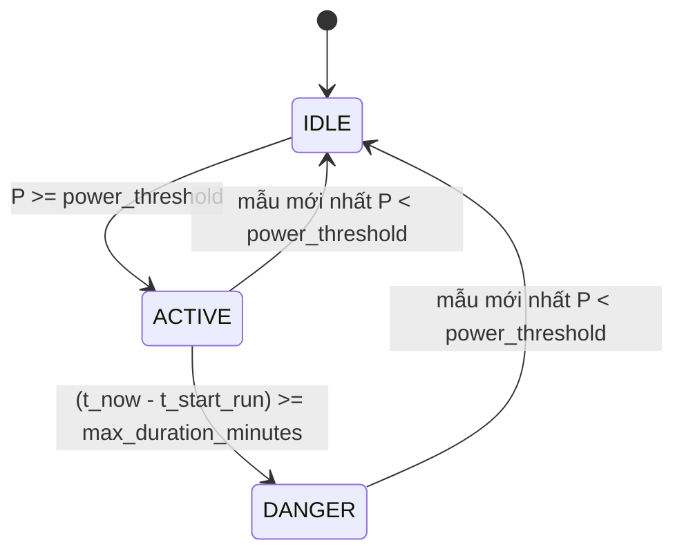

# Specification: SPEC-ELM-L1 — Deterministic Safety Rule Engine

## Changelog
| Ngày | Version | Người thực hiện | Nội dung |
|---|---|---|---|
| 2026-10-25 | 1.3.0 | Claude Code | Từ chối timestamp NaT/không parse được/lệch độ dài/không tăng chặt ở cả hai detector trước mọi nhánh trả sớm (EC-08); giữ nguyên ngưỡng |
| 2026-10-23 | 1.2.0 | Codex | Từ chối công suất NaN/vô cực/không phải số ở cả hai detector trước mọi nhánh trả sớm; giữ nguyên ngưỡng |
| 2026-10-13 | 1.0.0 | Claude Code (soạn) | Viết ngược (reverse-spec) từ code hiện có |
| 2026-10-13 | 1.1.0 | Claude Code (soạn) | Bổ sung EC-01, EC-04, EC-06 theo Logic Issues L1-L1..L1-L3 trong `TDD-ELM-L1` |

## 1. Context & Problem Statement
Thiết bị sinh nhiệt công suất lớn (ấm siêu tốc, bàn là, máy sấy tóc) bị bật quên là nguyên nhân phổ biến gây cháy nổ dân dụng.
Lớp 1 dùng luật tất định (không học máy) để cảnh báo với độ tin cậy cao. Chuỗi công suất đầu vào là đầu ra NILM `y_i(t)`
hoặc công suất tổng. Lớp này cũng phát hiện chùm xung công suất ngắn bất thường (dấu hiệu tiếp xúc lỏng / hồ quang).

## 2. Scope
### 2.1 In-Scope
- Kiểm tra "quên tắt" cho 3 thiết bị có cấu hình: `kettle`, `iron`, `hair_dryer`.
- Phát hiện chùm xung vọt công suất ngắn (micro-arc) trên công suất tổng.
- Trả về `SafetyAlert` có cấu trúc (thời điểm, thiết bị, mức độ, loại, thông điệp, thời lượng, công suất).

### 2.2 Out-of-Scope (Non-Goals)
- Không tự ngắt điện / điều khiển rơ-le (chỉ cảnh báo).
- Không bóc tách NILM (do `SPEC-ELM-NILM`).
- Không phát hiện hồ quang ở tần số cao (kHz) — chỉ làm việc trên chuỗi công suất lấy mẫu ≥ 1 s.
- Không đo/đảm bảo độ trễ P99 < 1 s (mục tiêu kiến trúc, chưa có benchmark).

## 3. Behavior
### 3.1 Máy trạng thái "quên tắt" cho một thiết bị

`t_start_run` = timestamp mẫu đầu tiên của chuỗi mẫu liên tiếp (theo thứ tự trong series) có `P >= power_threshold` tính ngược từ mẫu cuối.
Thời lượng tính bằng hiệu timestamp, **không** bằng số mẫu.

### 3.2 Định nghĩa xung micro-arc
Một xung = cạnh lên `ΔP > spike_threshold_watts` tại `t_rise`, tiếp theo là cạnh xuống `ΔP < -spike_threshold_watts` tại `t_fall`,
với `t_fall - t_rise <= max_duration_seconds`. Chỉ đếm xung có `t_rise >= t_now - cluster_window_minutes`.
Cảnh báo khi số xung `>= min_spike_count` (mặc định 3).

### 3.3 Hợp đồng giao diện
- `DeterministicRuleEngine.check_forgotten_appliance(appliance_key, series, timestamps) -> Optional[SafetyAlert]`
- `DeterministicRuleEngine.check_micro_arc_and_spikes(total_power_series, timestamps, spike_threshold_watts=2500.0, max_duration_seconds=5.0, cluster_window_minutes=10.0, min_spike_count=3) -> Optional[SafetyAlert]`

### 3.4 Ngưỡng an toàn (bị ghim bởi test, chỉ được siết chặt)
| Thiết bị | `power_threshold` (W) | `max_duration_minutes` |
|---|---|---|
| kettle — Ấm siêu tốc | 1200.0 | 15.0 |
| iron — Bàn là | 800.0 | 90.0 |
| hair_dryer — Máy sấy tóc | 1000.0 | 30.0 |

### 3.5 Kiểm tra công suất đầu vào
Cả hai detector phải kiểm tra toàn bộ chuỗi công suất trước khi so ngưỡng hoặc
trả sớm vì mẫu cuối dưới ngưỡng hay chuỗi ít hơn hai mẫu. NaN, giá trị thiếu,
vô cực và giá trị không chuyển được sang số thực phải ném `ValueError` chứa
`power`. Không nội suy, điền 0 hoặc bỏ mẫu lỗi. Chuỗi rỗng vẫn theo EC-01;
key thiết bị lạ vẫn theo EC-04. Không thay đổi ngưỡng, thời lượng hoặc xử lý gap.

### 3.6 Kiểm tra timestamp đầu vào
Sau khi kiểm tra công suất (§3.5) và trước mọi so ngưỡng hay trả sớm, cả hai
detector phải kiểm tra toàn bộ chuỗi timestamp. Phải ném `ValueError` chứa
`timestamp` khi: (a) số timestamp khác số mẫu công suất; (b) có giá trị thiếu/NaT
hoặc không chuyển được sang thời điểm; (c) chuỗi không tăng chặt (đảo thứ tự hoặc
trùng lặp). Không sắp xếp lại, bỏ hoặc nội suy timestamp: thời lượng âm/NaN từ
timestamp hỏng không được biến thành "không cảnh báo". Hai chuỗi cùng rỗng vẫn
theo EC-01. Gap hợp lệ (tăng chặt nhưng thưa) vẫn theo EC-03. Không đổi ngưỡng.

## 4. Edge Cases
- **EC-08**: Timestamp không hợp lệ — NaT ở đầu/giữa/cuối, giá trị không parse được, độ dài lệch chuỗi công suất, đảo thứ tự hoặc trùng lặp, kể cả khi mẫu cuối đã tắt hoặc chỉ có một mẫu → `ValueError` chứa `timestamp` ở cả hai detector; không trả `None` hoặc cảnh báo.
- **EC-07**: Công suất không hợp lệ ở đầu/giữa/cuối chuỗi, kể cả một mẫu duy nhất hoặc mẫu cuối hợp lệ đã tắt → `ValueError` ở cả hai detector; không trả `None` hoặc cảnh báo từ dữ liệu hỏng.
- **EC-01**: Series rỗng → trả về `None`, không ném `IndexError`.
- **EC-02**: Biên thời lượng: chạy đúng `max_duration_minutes` (15,0 phút) → cảnh báo; 14,0 phút → không cảnh báo.
- **EC-03**: Khoảng trống dữ liệu giữa các mẫu active (mất gói IoT) **không** reset bộ đếm — fail-closed: thiếu dữ liệu không phải bằng chứng thiết bị đã tắt.
- **EC-04**: `appliance_key` không có trong cấu hình → ném `ValueError` (fail-loud), không im lặng trả `None`.
- **EC-05**: Công suất đúng bằng ngưỡng (1200,0 W) được tính là active (`>=`).
- **EC-06**: Không đếm là xung micro-arc: (a) xung nằm ngoài cửa sổ `cluster_window_minutes`; (b) bậc tải kéo dài hơn `max_duration_seconds` (tải thật bật lên).

## 5. Success Criteria
- **AC-01**: Ấm siêu tốc `>= 1200 W` liên tục `>= 15 phút` → `SafetyAlert(severity="DANGER", alert_type="FORGOTTEN_DEVICE")` với `active_duration_minutes` và `current_power_watts` đúng.
- **AC-02**: Bàn là (`>= 800 W`, `>= 90 phút`) và máy sấy tóc (`>= 1000 W`, `>= 30 phút`) cảnh báo tương tự.
- **AC-03**: Mẫu mới nhất dưới ngưỡng → `None` dù trước đó đã chạy lâu.
- **AC-04**: `>= 3` xung ngắn (`ΔP > 2500 W`, dài `<= 5 s`) trong 10 phút gần nhất → `SafetyAlert(severity="WARNING", alert_type="ARC_FAULT")`, thông điệp nêu đúng số xung.
- **AC-05**: Bảng ngưỡng mục 3.4 hiện diện và đúng giá trị trong code.

## 6. Implementation & Traceability Matrix
| Mã | Loại | Mô tả | Module | Test neo (`@spec`) | TC |
|---|:---:|---|---|---|---|
| EC-07 | EC | Công suất hỏng phải fail-loud | `rule_engine.py` | `tests/test_rule_engine.py` | L1-TC-013 |
| EC-08 | EC | Timestamp hỏng phải fail-loud | `rule_engine.py` | `tests/test_rule_engine.py` | L1-TC-014 |
| AC-01 | AC | Ấm siêu tốc quên tắt | `rule_engine.py` | `tests/test_rule_engine.py` | L1-TC-001 |
| AC-02 | AC | Bàn là, máy sấy tóc | `rule_engine.py` | `tests/test_rule_engine.py` | L1-TC-003 |
| AC-03 | AC | Đã tắt → không cảnh báo | `rule_engine.py` | `tests/test_rule_engine.py` | L1-TC-004 |
| AC-04 | AC | Chùm xung micro-arc | `rule_engine.py` | `tests/test_rule_engine.py` | L1-TC-009 |
| AC-05 | AC | Ghim ngưỡng an toàn | `rule_engine.py` | `tests/test_rule_engine.py` | L1-TC-012 |
| EC-01 | EC | Series rỗng | `rule_engine.py` | `tests/test_rule_engine.py` | L1-TC-007 |
| EC-02 | EC | Biên 15,0 / 14,0 phút | `rule_engine.py` | `tests/test_rule_engine.py` | L1-TC-002 |
| EC-03 | EC | Khoảng trống dữ liệu | `rule_engine.py` | `tests/test_rule_engine.py` | L1-TC-006 |
| EC-04 | EC | Key không tồn tại | `rule_engine.py` | `tests/test_rule_engine.py` | L1-TC-008 |
| EC-05 | EC | Đúng bằng ngưỡng công suất | `rule_engine.py` | `tests/test_rule_engine.py` | L1-TC-005 |
| EC-06 | EC | Xung ngoài cửa sổ / tải kéo dài | `rule_engine.py` | `tests/test_rule_engine.py` | L1-TC-010, L1-TC-011 |
