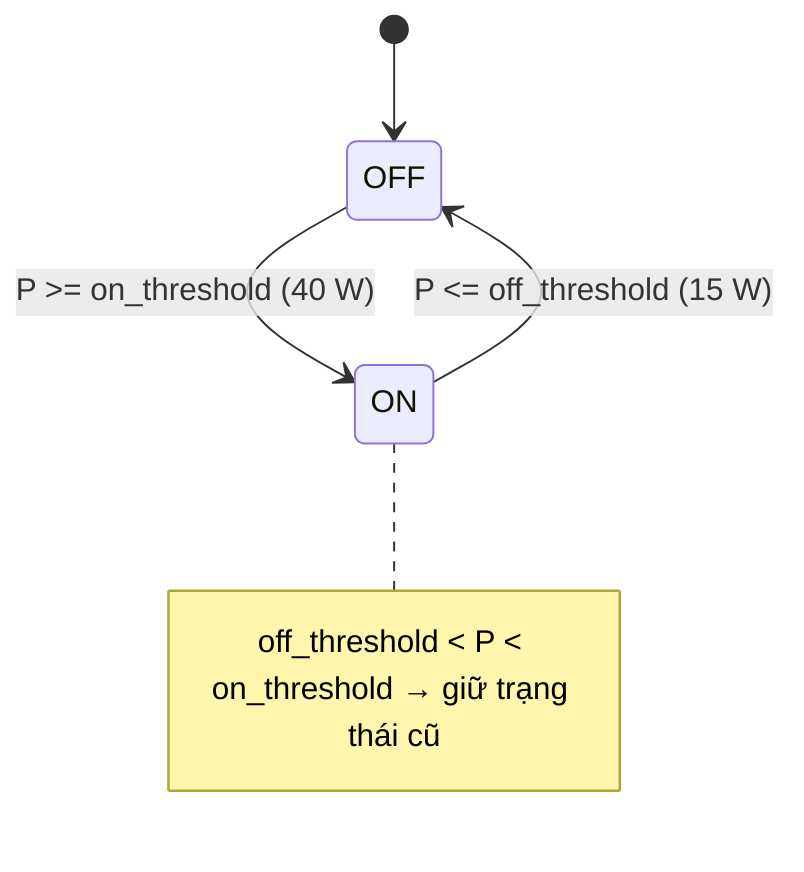

# Specification: SPEC-ELM-L2A — Fridge Duty Cycle Analyzer

## Changelog
| Ngày | Version | Người thực hiện | Nội dung |
|---|---|---|---|
| 2026-10-13 | 1.0.0 | Claude Code (soạn) | Viết ngược từ code hiện có |
| 2026-10-13 | 1.1.0 | Claude Code (soạn) | Chỉ tính chu kỳ hoàn chỉnh (EC-03); bỏ khẳng định IQR khỏi README (Logic Issues L2A-L1..L3) |

## 1. Context & Problem Statement
Máy nén tủ lạnh non-inverter chạy theo chu kỳ ON/OFF. Tủ khỏe chạy ~50% thời gian; khi hở gioăng, dàn nóng bẩn hoặc rò gas,
máy nén phải chạy lâu hơn → Duty Cycle `DC = T_ON / (T_ON + T_OFF)` tăng. Module phát hiện sự suy thoái này từ chuỗi công suất tủ lạnh.

## 2. Scope
### 2.1 In-Scope
- Tiền xử lý: resample về lưới thời gian đều, forward/back-fill, median filter cửa sổ 3.
- Phân đoạn ON/OFF bằng hysteresis 2 ngưỡng (`on_threshold_watts`, `off_threshold_watts`).
- Trích chu kỳ ON+OFF hoàn chỉnh, tính DC, Z-score so với chuẩn cấu hình, gắn nhãn bất thường.

### 2.2 Out-of-Scope (Non-Goals)
- Không dùng IQR / không tự học baseline riêng cho từng tủ (dùng `normal_duty_cycle_mean/std` cấu hình).
- Không hỗ trợ tủ lạnh inverter (máy nén điều biến liên tục, không có chu kỳ ON/OFF rõ).
- Không chẩn đoán phân biệt hở gioăng vs rò gas vs dàn nóng bẩn (chỉ nêu nghi ngờ).

## 3. Behavior
### 3.1 Hysteresis (Schmitt trigger)

### 3.2 Chu kỳ hoàn chỉnh
Chu kỳ = cạnh lên ON tại `start_on` → cạnh xuống tại `end_on` → cạnh lên kế tiếp tại `end_off`.
Chu kỳ đầu (dữ liệu bắt đầu khi đang ON) và chu kỳ cuối (pha OFF bị cắt bởi hết dữ liệu) là **không hoàn chỉnh** và bị loại.

### 3.3 Phân loại
| Điều kiện (theo thứ tự) | `is_anomaly` | `reason` bắt đầu bằng |
|---|---|---|
| `DC >= 80%` | True | `CẢNH BÁO NGUY HIỂM` |
| `DC >= 68%` hoặc `z > z_threshold` (2,5) | True | `CẢNH BÁO HAO MÒN` |
| còn lại | False | `Bình thường` |

`z = (DC/100 - normal_duty_cycle_mean) / normal_duty_cycle_std`.

### 3.4 Hợp đồng giao diện
- `preprocess_raw_signal(df, timestamp_col, power_col, resample_rule="1min") -> DataFrame` (index thời gian, cột `power_smoothed`)
- `segment_states_hysteresis(series) -> Series[int]`
- `extract_cycles(smoothed_df, power_col="power_smoothed") -> List[CycleMetrics]`
- `to_summary_dataframe(cycles) -> DataFrame`

## 4. Edge Cases
- **EC-01**: DataFrame rỗng → `extract_cycles` trả `[]`, không ném lỗi.
- **EC-02**: Công suất nằm giữa hai ngưỡng (15 W < P < 40 W) giữ nguyên trạng thái trước đó (chống rung trạng thái).
- **EC-03**: Chu kỳ không hoàn chỉnh ở đầu và cuối dữ liệu bị loại — tránh DC giả (vd 30 phút ON + 1 phút OFF bị cắt → 96,8% báo động giả).
- **EC-04**: Chu kỳ tổng `< min_cycle_duration_minutes` (5 phút, do mở/đóng cửa) bị loại.
- **EC-05**: Biên phân loại: DC đúng 80,0% → NGUY HIỂM; DC đúng 68,0% → HAO MÒN.

## 5. Success Criteria
- **AC-01**: Tủ chạy 30 phút ON / 30 phút OFF → DC = 50,0%, `is_anomaly = False`, `reason = "Bình thường"`.
- **AC-02**: Tủ chạy 50 phút ON / 10 phút OFF → DC ≈ 83,3%, `is_anomaly = True`, lý do NGUY HIỂM.
- **AC-03**: DC trong [68%, 80%) → `is_anomaly = True`, lý do HAO MÒN.
- **AC-04**: Z-score `> z_threshold` dù DC < 68% → HAO MÒN (vd chuẩn 30% ± 5%, đo 50% → z = 4).
- **AC-05**: Tiền xử lý đưa dữ liệu lệch nhịp/trùng lặp về lưới 1 phút liên tục và median filter loại xung nhiễu 1 mẫu.

## 6. Implementation & Traceability Matrix
| Mã | Loại | Mô tả | Module | Test neo (`@spec`) | TC |
|---|:---:|---|---|---|---|
| AC-01 | AC | 30/30 bình thường | `duty_cycle.py` | `tests/test_duty_cycle.py` | L2A-TC-001 |
| AC-02 | AC | 50/10 nguy hiểm | `duty_cycle.py` | `tests/test_duty_cycle.py` | L2A-TC-002 |
| AC-03 | AC | Vùng hao mòn | `duty_cycle.py` | `tests/test_duty_cycle.py` | L2A-TC-003 |
| AC-04 | AC | Z-score vượt ngưỡng | `duty_cycle.py` | `tests/test_duty_cycle.py` | L2A-TC-004 |
| AC-05 | AC | Tiền xử lý | `duty_cycle.py` | `tests/test_duty_cycle.py` | L2A-TC-005 |
| EC-01 | EC | DataFrame rỗng | `duty_cycle.py` | `tests/test_duty_cycle.py` | L2A-TC-006 |
| EC-02 | EC | Hysteresis giữ trạng thái | `duty_cycle.py` | `tests/test_duty_cycle.py` | L2A-TC-007 |
| EC-03 | EC | Loại chu kỳ không hoàn chỉnh | `duty_cycle.py` | `tests/test_duty_cycle.py` | L2A-TC-008, L2A-TC-009 |
| EC-04 | EC | Loại chu kỳ quá ngắn | `duty_cycle.py` | `tests/test_duty_cycle.py` | L2A-TC-010 |
| EC-05 | EC | Biên 80% / 68% | `duty_cycle.py` | `tests/test_duty_cycle.py` | L2A-TC-011 |
