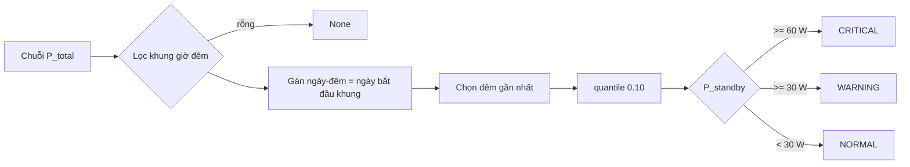

# Specification: SPEC-ELM-L2B — Vampire Power Detector

## Changelog
| Ngày | Version | Người thực hiện | Nội dung |
|---|---|---|---|
| 2026-10-13 | 1.0.0 | Claude Code (soạn) | Viết ngược từ code hiện có |
| 2026-10-13 | 1.1.0 | Claude Code (soạn) | Hỗ trợ khung giờ qua nửa đêm (EC-02); phân tích đêm gần nhất (EC-03) — Logic Issues L2B-L1, L2B-L2 |

## 1. Context & Problem Statement
Thiết bị cắm 24/7 (TV standby, adapter, router, TV box) tiêu thụ "điện ma". Vào giờ cả nhà ngủ, công suất tổng gần như chỉ còn
tải nền này cộng chu kỳ tủ lạnh. Lấy phân vị thấp (10%) của công suất tổng trong khung giờ đêm sẽ loại phần lớn pha ON của tủ lạnh
và cho ước lượng tải chờ, từ đó quy ra kWh/tháng và tiền điện.

## 2. Scope
### 2.1 In-Scope
- Lọc khung giờ đêm `[night_start_hour, night_end_hour)`, kể cả khung qua nửa đêm (vd 23 → 2).
- Ước lượng tải chờ bằng `quantile(0.10)` của đêm **gần nhất** trong dữ liệu.
- Quy đổi `kWh/tháng = P × 24 × 30 / 1000`, chi phí = kWh × `electricity_tariff_vnd_per_kwh`.
- Phân cấp `NORMAL / WARNING / CRITICAL` kèm khuyến nghị.

### 2.2 Out-of-Scope (Non-Goals)
- Không nhận diện thiết bị cụ thể gây tải chờ.
- Không tính giá điện bậc thang EVN (dùng đơn giá phẳng).
- Không trừ công suất pha OFF của tủ lạnh (~2 W) — ước lượng có thể cao hơn tải chờ thật vài W (giới hạn đã biết).

## 3. Behavior

Ngày-đêm: nếu khung qua nửa đêm, mẫu có `giờ < night_end_hour` thuộc đêm của ngày hôm trước.

Hợp đồng: `VampirePowerDetector.analyze_night_standby(df, timestamp_col="timestamp", power_col="total_power") -> Optional[VampireReport]`.

## 4. Edge Cases
- **EC-01**: Không có mẫu nào trong khung giờ đêm → `None`.
- **EC-02**: Khung giờ qua nửa đêm (`night_start_hour=23`, `night_end_hour=2`) vẫn lọc đúng; `analysis_date` là ngày bắt đầu khung.
- **EC-03**: Dữ liệu nhiều đêm → chỉ phân tích đêm gần nhất; `analysis_date` đúng ngày của đêm đó.
- **EC-04**: Biên phân cấp: đúng 30,0 W → WARNING; đúng 60,0 W → CRITICAL (`>=`).
- **EC-05**: Tủ lạnh chạy 50% thời gian trong khung đêm không làm tăng ước lượng tải chờ.

## 5. Success Criteria
- **AC-01**: `standby_power_watts` = `quantile(0.10)` công suất đêm, làm tròn 1 chữ số.
- **AC-02**: `monthly_waste_kwh = P × 0,72` (làm tròn 2 chữ số); `estimated_monthly_cost_vnd = kWh × đơn giá` (làm tròn 0).
- **AC-03**: Phân cấp đúng; `is_anomaly = True` với WARNING/CRITICAL; `recommendations` không rỗng ở mọi cấp.

## 6. Implementation & Traceability Matrix
| Mã | Loại | Mô tả | Module | Test neo (`@spec`) | TC |
|---|:---:|---|---|---|---|
| AC-01 | AC | Quantile 0.10 | `vampire_power.py` | `tests/test_vampire_power.py` | L2B-TC-001 |
| AC-02 | AC | Quy đổi kWh, VNĐ | `vampire_power.py` | `tests/test_vampire_power.py` | L2B-TC-002 |
| AC-03 | AC | Phân cấp & khuyến nghị | `vampire_power.py` | `tests/test_vampire_power.py` | L2B-TC-003 |
| EC-01 | EC | Không có dữ liệu đêm | `vampire_power.py` | `tests/test_vampire_power.py` | L2B-TC-004 |
| EC-02 | EC | Qua nửa đêm | `vampire_power.py` | `tests/test_vampire_power.py` | L2B-TC-005 |
| EC-03 | EC | Nhiều đêm | `vampire_power.py` | `tests/test_vampire_power.py` | L2B-TC-006 |
| EC-04 | EC | Biên 30 W / 60 W | `vampire_power.py` | `tests/test_vampire_power.py` | L2B-TC-003 |
| EC-05 | EC | Tủ lạnh chạy chu kỳ | `vampire_power.py` | `tests/test_vampire_power.py` | L2B-TC-001 |
