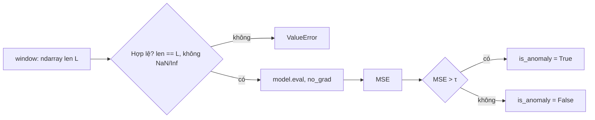

# Specification: SPEC-ELM-L3 — Inverter Anomaly Detector

## Changelog
| Ngày | Version | Người thực hiện | Nội dung |
|---|---|---|---|
| 2026-10-13 | 1.0.0 | Claude Code (soạn) | Viết ngược từ code hiện có |
| 2026-10-13 | 1.1.0 | Claude Code (soạn) | Kiểm tra đầu vào fail-loud (EC-01, EC-02, EC-04) — Logic Issues L3-L1..L3 |

## 1. Context & Problem Statement
Thiết bị biến tần (điều hòa inverter, động cơ BLDC) không có chu kỳ ON/OFF rõ nên không dùng được Duty Cycle.
Autoencoder huấn luyện chỉ trên dữ liệu "khỏe" sẽ tái tạo kém khi hình dạng sóng công suất thay đổi (lưới lọc bẩn, kẹt cơ).
Sai số tái tạo `MSE > τ` → cảnh báo suy giảm phần cứng.

## 2. Scope
### 2.1 In-Scope
- Kiến trúc `Conv1DAutoencoder` (encoder 3 tầng stride 2, decoder đối xứng).
- `InverterAnomalyDetector.compute_reconstruction_loss(window) -> (mse, is_anomaly)` ở chế độ inference.
- Kiểm tra tính hợp lệ của cấu hình và đầu vào.

### 2.2 Out-of-Scope (Non-Goals)
- Vòng huấn luyện, chọn/hiệu chỉnh ngưỡng `τ` (hiện là hằng 0,045 chưa có căn cứ — GAP mở).
- Chuẩn hóa dữ liệu (đầu vào được giả định đã chuẩn hóa).
- Lưu/nạp checkpoint.

## 3. Behavior

Ràng buộc kiến trúc: `sequence_length` chia hết cho 8 (3 tầng stride 2) để đầu ra cùng độ dài với đầu vào.

## 4. Edge Cases
- **EC-01**: `sequence_length` không chia hết cho 8 (hoặc ≤ 0) → `ValueError` khi khởi tạo.
- **EC-02**: Độ dài window khác `sequence_length` của model → `ValueError`.
- **EC-03**: `MSE == τ` → không bất thường (so sánh chặt `>`).
- **EC-04**: Window chứa NaN/Inf → `ValueError`. (Nếu không chặn: `MSE = NaN`, `NaN > τ` là False → bỏ sót im lặng.)

## 5. Success Criteria
- **AC-01**: Đầu ra autoencoder có cùng shape `(B, 1, L)` với đầu vào.
- **AC-02**: `MSE > τ` → `is_anomaly = True`; `MSE < τ` → `False`; MSE trả về là `float`.
- **AC-03**: Inference tất định: hai lần gọi cùng window cho cùng MSE (model ở chế độ `eval`).

## 6. Implementation & Traceability Matrix
| Mã | Loại | Mô tả | Module | Test neo (`@spec`) | TC |
|---|:---:|---|---|---|---|
| AC-01 | AC | Shape đầu ra | `autoencoder.py` | `tests/test_autoencoder.py` | L3-TC-001 |
| AC-02 | AC | Quyết định theo τ | `autoencoder.py` | `tests/test_autoencoder.py` | L3-TC-002 |
| AC-03 | AC | Tất định | `autoencoder.py` | `tests/test_autoencoder.py` | L3-TC-003 |
| EC-01 | EC | seq_len không chia hết 8 | `autoencoder.py` | `tests/test_autoencoder.py` | L3-TC-004 |
| EC-02 | EC | Sai độ dài window | `autoencoder.py` | `tests/test_autoencoder.py` | L3-TC-005 |
| EC-03 | EC | MSE đúng bằng τ | `autoencoder.py` | `tests/test_autoencoder.py` | L3-TC-002 |
| EC-04 | EC | NaN/Inf | `autoencoder.py` | `tests/test_autoencoder.py` | L3-TC-006 |
