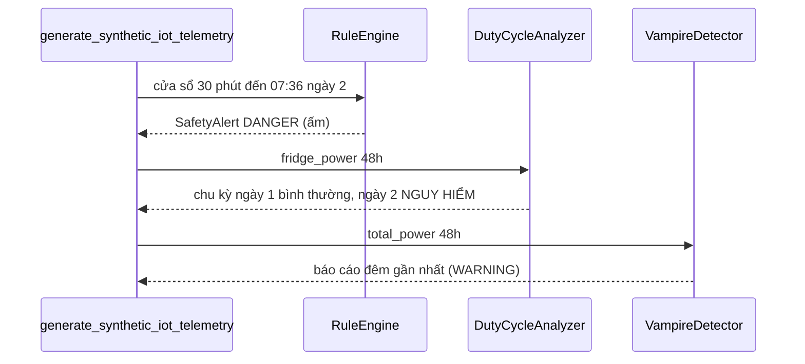

# Specification: SPEC-ELM-SYS-001 — POC Detective Pipeline

## Changelog
| Ngày | Version | Người thực hiện | Nội dung |
|---|---|---|---|
| 2026-10-13 | 1.0.0 | Claude Code (soạn) | Viết ngược từ `demo_pipeline.py` |
| 2026-10-13 | 1.1.0 | Claude Code (soạn) | Seed tái lập (EC-01); kết luận POC phản ánh kết quả thật + mã thoát (EC-02) — Logic Issues SYS-L1, SYS-L2 |

## 1. Context & Problem Statement
POC chứng minh 3 kịch bản của Module Thám tử trên 48 giờ dữ liệu tổng hợp (1 mẫu/phút): ấm siêu tốc quên tắt (Lớp 1),
tủ lạnh hở gioăng (Lớp 2 — Duty Cycle), tải ma ban đêm (Lớp 2 — Vampire). Spec này là cơ sở cho integration test.

## 2. Scope
### 2.1 In-Scope
- `generate_synthetic_iot_telemetry(seed)`: ngày 1 tủ lạnh 30/30 phút; ngày 2 tủ lạnh 50/10 phút; ấm 1800 W từ 07:15 đến 07:37 ngày 2;
  tải nền 48 W suốt 48 giờ.
- `run_poc_demonstration() -> bool`: chạy 3 kịch bản, in báo cáo, trả `True` khi cả 3 đạt.

### 2.2 Out-of-Scope (Non-Goals)
- Lớp 3 và Seq2Point (chưa có model huấn luyện).
- Dữ liệu đo thật.

## 3. Behavior

## 4. Edge Cases
- **EC-01**: Cùng `seed` → dữ liệu giống hệt nhau (kết quả demo tái lập được).
- **EC-02**: Dòng kết luận "ĐẠT" chỉ in khi cả 3 kịch bản đạt; script trả mã thoát 1 nếu không đạt.

## 5. Success Criteria
- **AC-01**: Tại 07:36 ngày 2, Lớp 1 phát `SafetyAlert` DANGER cho "Ấm siêu tốc" với thời lượng ≥ 15 phút.
- **AC-02**: Mọi chu kỳ hoàn chỉnh bắt đầu ở ngày 1 có DC ≈ 50% và không bất thường; mọi chu kỳ hoàn chỉnh bắt đầu ở ngày 2 có DC ≥ 80% và bất thường.
- **AC-03**: Báo cáo Vampire cho đêm 2026-10-02 có tải chờ trong khoảng 45–55 W, mức WARNING.

## 6. Implementation & Traceability Matrix
| Mã | Loại | Mô tả | Module | Test neo (`@spec`) | TC |
|---|:---:|---|---|---|---|
| AC-01 | AC | Ấm quên tắt | `demo_pipeline.py`, `rule_engine.py` | `tests/integration/test_poc_pipeline.py` | SYS-TC-INT-001 |
| AC-02 | AC | Tủ lạnh hở gioăng | `demo_pipeline.py`, `duty_cycle.py` | `tests/integration/test_poc_pipeline.py` | SYS-TC-INT-002 |
| AC-03 | AC | Tải ma ban đêm | `demo_pipeline.py`, `vampire_power.py` | `tests/integration/test_poc_pipeline.py` | SYS-TC-INT-003 |
| EC-01 | EC | Seed tái lập | `demo_pipeline.py` | `tests/integration/test_poc_pipeline.py` | SYS-TC-INT-004 |
| EC-02 | EC | Kết luận trung thực | `demo_pipeline.py` | `tests/integration/test_poc_pipeline.py` | SYS-TC-INT-005 |
